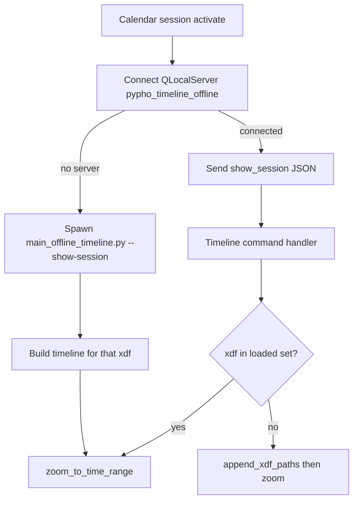

# Calendar → offline timeline handoff

## Goal

From the session calendar, activating a session (double-click / “Open in Timeline”) will:

1. **If offline timeline is already running and that XDF is loaded** → zoom the viewport to the session’s time range (no reload).
2. **If timeline is running but the XDF is not loaded** → append that XDF’s tracks into the existing viewer, then zoom.
3. **If timeline is not running** → start offline timeline with that XDF and zoom after build.

Session identity is the catalog **`xdf_path`** (plus `recording_datetime` / `duration_sec` for zoom). Offline viewer remains XDF-based; processing status is only used for UX (e.g. prefer computed sessions), not as a different data format.

## Locked approach

**Cross-process QLocalServer IPC** (not merging calendar into the timeline window). Keeps existing ActionButtons (`Session Calendar` vs Historical Timeline) working while making handoff cheap when the viewer is already open. Full `replace_timeline_from_xdf_paths` rebuild is **not** used for the “already open, missing file” case.

## pyPhoTimeline changes

### 1. Zoom API on `SimpleTimelineWidget`

Add [`zoom_to_time_range(start, end)`](c:\Users\pho\repos\EmotivEpoc\ACTIVE_DEV\pyPhoTimeline\pypho_timeline\widgets\simple_timeline_widget.py) that sets `active_window_*` to the session span (small padding, e.g. 2%), expands total range if needed, then reuses the existing update path (`update_window` / `window_scrolled`) already used by [`simulate_window_scroll`](c:\Users\pho\repos\EmotivEpoc\ACTIVE_DEV\pyPhoTimeline\pypho_timeline\widgets\simple_timeline_widget.py).

### 2. Append-without-rebuild on `TimelineBuilder`

Add [`ensure_xdf_loaded(xdf_path) -> bool`](c:\Users\pho\repos\EmotivEpoc\ACTIVE_DEV\pyPhoTimeline\pypho_timeline\timeline_builder.py):

- If `Path(xdf_path).resolve()` is in `_loaded_xdf_paths` → return True (already present).
- Else collect datasources via existing `_collect_new_datasources_for_xdf_path`, `update_timeline(..., update_time_range=True)`, add to `_loaded_xdf_paths`.

Expose a thin wrapper on [`MainTimelineWindow`](c:\Users\pho\repos\EmotivEpoc\ACTIVE_DEV\pyPhoTimeline\pypho_timeline\widgets\TimelineWindow\MainTimelineWindow.py): `show_session(xdf_path, start=None, end=None)` → ensure loaded → zoom using start/end or metadata from the loaded file / HistoricalSessions intervals.

### 3. Offline command server

In [`main_offline_timeline.py`](c:\Users\pho\repos\EmotivEpoc\ACTIVE_DEV\pyPhoTimeline\main_offline_timeline.py) (and any shared bootstrap used by the offline window):

- Start `QLocalServer` named `pypho_timeline_offline` after the main window exists.
- On new connection, read one JSON line: `{"cmd":"show_session","xdf_path":"...","start": iso|unix|null, "end": ...}`.
- Call `main_window.show_session(...)`, raise/focus the window.
- On quit, close/remove the server.

### 4. Cold-start CLI

Extend `main_offline_timeline.py` with argparse:

- `--show-session PATH` (required for handoff spawn)
- optional `--start` / `--end` (ISO or unix)

When provided, build from that single XDF (fast path) instead of the large discovery batch, then zoom. Keep current no-arg behavior unchanged for the Historical Timeline button.

## PhoOfflineEEGAnalysis calendar changes

### 5. Handoff client

Add a small helper (e.g. `analysis/timeline_handoff.py`):

- Try `QLocalSocket` connect to `pypho_timeline_offline` (short timeout).
- On success: write `show_session` JSON and return.
- On failure: `subprocess.Popen` the pyPhoTimeline venv/`uv run` python with `main_offline_timeline.py --show-session <xdf_path> ...` (cwd = pyPhoTimeline; resolve interpreter the same way ActionButtons do, or `sys.executable` if packages share an env).

### 6. Calendar UI wiring

In [`SessionCalendarWindow`](c:\Users\pho\repos\EmotivEpoc\ACTIVE_DEV\PhoOfflineEEGAnalysis\src\phoofflineeeganalysis\analysis\UI\CustomCalendarWidget.py):

- Store richer `UserRole` payload: `{xdf_path, recording_datetime, duration_sec, status}`.
- Double-click session list item (and optional toolbar button “Open in Timeline”) → call handoff client.
- Raise a brief status/`QMessageBox` only on hard failures (missing path, spawn error).

### 7. Docs / ActionButtons

- Update [`SESSION_CALENDAR.md`](c:\Users\pho\repos\EmotivEpoc\ACTIVE_DEV\PhoOfflineEEGAnalysis\src\phoofflineeeganalysis\analysis\SESSION_CALENDAR.md) with the click → zoom/load behavior.
- No new ActionButton required; handoff is from the calendar UI. Optionally note that Historical Timeline should be left running for instant zoom.

## Efficiency notes

- Zoom-only path: no XDF I/O.
- Append path: load one file’s streams into the existing widget (reuse `_collect_new_datasources_for_xdf_path` / `update_timeline`), not full window replace.
- Cold start: single-file `build_from_xdf_file` instead of discovering N recent sessions.

## Out of scope

- Loading processed FIF/HTML/spectrogram products into the timeline (still XDF streams).
- Embedding the month calendar inside `MainTimelineWindow`.
- Changing live LSL timeline.
