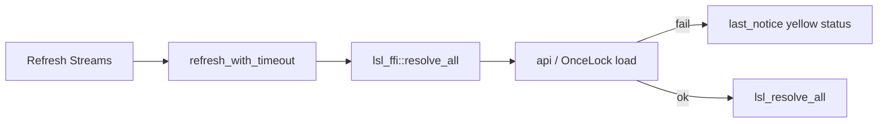

# Fix LSL Stream Discovery (liblsl load on Windows)

## Diagnosis

The empty stream list is a **downstream symptom**. The status bar already shows the real failure: `LSL error: liblsl shared library could not be loaded: ...`.

[`candidate_library_names()`](c:\Users\pho\repos\EmotivEpoc\ACTIVE_DEV\emotiv-rs-recorder\crates\lsl-ffi\src\lib.rs) on Windows only tries:

1. `LSL_LIB` / `PYLSL_LIB`
2. `{exe_dir}\lsl.dll` / `liblsl.dll`
3. bare `lsl.dll` / `liblsl.dll` (PATH / LoadLibrary defaults)

macOS/Linux get absolute fallbacks; Windows does not. This machine already has `lsl.dll` at `~\.local\lib\liblsl\bin\lsl.dll` and under App-LabRecorder `out\`, but neither is searched. There is also **no** post-build copy of `lsl.dll` next to `target\debug\emotiv-rs-recorder.exe` (unlike App-LabRecorder’s CMake `POST_BUILD`).

Refresh path: [`refresh_streams_and_select_own`](c:\Users\pho\repos\EmotivEpoc\ACTIVE_DEV\emotiv-rs-recorder\crates\emotiv-rs-app\src\app.rs) → `LslRecordingEngine::refresh_with_timeout` → `lsl_ffi::resolve_all` → `api()?` fails before any network resolve.

## Approach

Mirror the Windows search locations already used by [`python_xdf_streamer`’s `find_liblsl`](c:\Users\pho\repos\EmotivEpoc\ACTIVE_DEV\python_xdf_streamer\src\xdf_streamer\utils\liblsl_setup.py), make the UI failure obvious in the streams panel, and document Windows setup. Do **not** change resolve wait times or discovery API wiring.

## Implementation

### 1. Windows well-known paths in `lsl-ffi`

In [`crates/lsl-ffi/src/lib.rs`](c:\Users\pho\repos\EmotivEpoc\ACTIVE_DEV\emotiv-rs-recorder\crates\lsl-ffi\src\lib.rs), extend the `#[cfg(target_os = "windows")]` branch of `candidate_library_names()` to append absolute candidates when they exist (or always append paths; load loop already tolerates misses):

- `{HOME}\.local\lib\liblsl\bin\lsl.dll` (and `liblsl.dll`)
- `{HOME}\libs\liblsl\bin\lsl.dll`
- `C:\libs\liblsl\bin\lsl.dll`

Keep existing env → exe-adjacent → bare-name order; insert well-known paths **before** bare names (same relative priority as macOS Homebrew entries).

### 2. Clearer Record-tab error when liblsl is missing

In [`crates/emotiv-rs-app/src/app.rs`](c:\Users\pho\repos\EmotivEpoc\ACTIVE_DEV\emotiv-rs-recorder\crates\emotiv-rs-app\src\app.rs):

- When refresh fails with a library-load error (or `!lsl_ffi::is_available()`), show a prominent message **inside** the “Discovered LSL Streams” panel (not only the faint yellow `last_notice`), including short remediation: set `LSL_LIB` / place `lsl.dll` next to the exe / use `~\.local\lib\liblsl\bin\lsl.dll`.
- Keep existing `last_notice` behavior.

### 3. Docs

Update [`README.md`](c:\Users\pho\repos\EmotivEpoc\ACTIVE_DEV\emotiv-rs-recorder\README.md) “Runtime `liblsl` Discovery” with a short Windows section:

- Primary DLL name is `lsl.dll`
- Search order including the new well-known paths
- Immediate unblock: `LSL_LIB=...\lsl.dll` or copy next to `target\{debug,release}\`
- Pointer to existing install flow (`python_xdf_streamer` `download_liblsl.py` → `~\.local\lib\liblsl\bin\`)

## Verification

1. Restart Studio after rebuild (`OnceLock` caches the first load failure for the process lifetime).
2. Confirm status no longer shows library-not-loaded; Refresh Streams either lists outlets or cleanly reports “0 streams” after a successful resolve wait.
3. Optional smoke: set `LSL_LIB` to App-LabRecorder’s `out\install\win-vs-release\lib\lsl.dll` if the user-local path is absent.

## Out of scope

- Bundling/shipping a vendored `lsl.dll` in-repo or a Cargo `build.rs` fetch (search-path parity is enough given existing local installs).
- Changing XDF writer / resolve timeout / Emotiv HID paths.