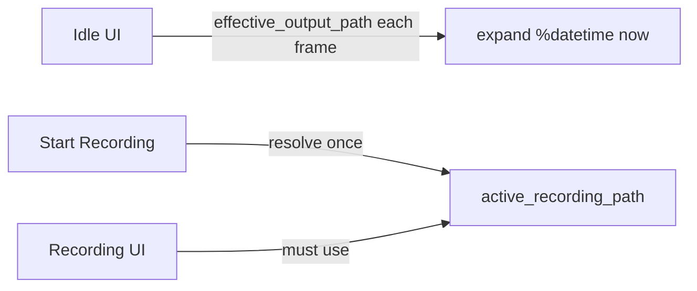

# Freeze XDF path while recording

## Problem

[`PathTemplate`](c:\Users\pho\repos\EmotivEpoc\ACTIVE_DEV\emotiv-rs-recorder\EmotivRSRecorder.cfg) uses `%datetime`. Every Record-panel paint calls [`effective_output_path()`](c:\Users\pho\repos\EmotivEpoc\ACTIVE_DEV\emotiv-rs-recorder\crates\emotiv-rs-app\src\app.rs) → [`resolve_output_path`](c:\Users\pho\repos\EmotivEpoc\ACTIVE_DEV\emotiv-rs-recorder\crates\recorder-core\src\config.rs) → [`expand_placeholders`](c:\Users\pho\repos\EmotivEpoc\ACTIVE_DEV\emotiv-rs-recorder\crates\recorder-core\src\config.rs), which calls `Utc::now()`, so the **Resolved:** label keeps changing.

The file itself is already correct: [`start_recording_session`](c:\Users\pho\repos\EmotivEpoc\ACTIVE_DEV\emotiv-rs-recorder\crates\emotiv-rs-app\src\app.rs) resolves once and passes that path into `recorder.start()`. [`LslRecordingEngine::active_recording_path()`](c:\Users\pho\repos\EmotivEpoc\ACTIVE_DEV\emotiv-rs-recorder\crates\recorder-core\src\engine.rs) already exposes that frozen path.

## Fix (UI-only in `app.rs`)

In [`ui_record_panel`](c:\Users\pho\repos\EmotivEpoc\ACTIVE_DEV\emotiv-rs-recorder\crates\emotiv-rs-app\src\app.rs):

1. Compute `is_recording` **before** the path/template group (move the existing `phase() == Streaming` check up).
2. For the **Resolved:** monospace line (template mode): if recording, display `self.recorder.active_recording_path()`; otherwise keep `effective_output_path()`.
3. While recording, disable edits that imply the open file could change: Direct path text edit, Study Root, Sub/Ses/Task/Modality/Run, BIDS checkbox, and the Direct vs Template radio. Split intentionally stops then starts with a freshly resolved path (and already bumps run / regenerates custom path) — leave that behavior.

No changes needed in `recorder-core` path expansion; idle preview should keep live `%datetime` expansion so the user sees what the next Start will produce.

## Touch point

- [`crates/emotiv-rs-app/src/app.rs`](c:\Users\pho\repos\EmotivEpoc\ACTIVE_DEV\emotiv-rs-recorder\crates\emotiv-rs-app\src\app.rs) — `ui_record_panel` only (~lines 723–814)