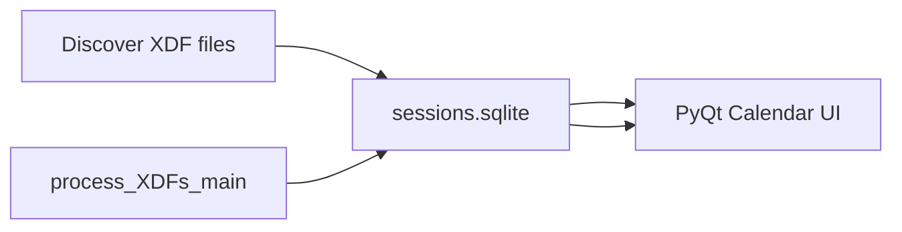

# Session calendar + discovery catalog (PyQt)

## Verdict on the existing calendar

**Not complete.** [`CustomCalendarWidget.py`](c:\Users\pho\repos\EmotivEpoc\ACTIVE_DEV\PhoOfflineEEGAnalysis\src\phoofflineeeganalysis\analysis\UI\CustomCalendarWidget.py) is a paint prototype:

- Renders red rectangles in day cells from `first_timestamp_rel` / `duration_rel` for streams named `"Epoc X"`
- No day-click detail panel, no processing status colors, leftover binge-status comments, debug `print`s
- No launcher / main window; not wired into [`main_analyze_run.py`](c:\Users\pho\repos\EmotivEpoc\ACTIVE_DEV\PhoOfflineEEGAnalysis\main_analyze_run.py)
- Docstring/notebook import path is wrong: `phoofflineeeganalysis.UI...` vs actual `phoofflineeeganalysis.analysis.UI...` (no `UI` package alias)

**Data prerequisite today:** needs a fully processed `xdf_stream_infos_df` from `XDFDataStreamAccessor.init_from_results` (after loading XDFs), not a discovery-only listing.

### How to use it today (after processing)

1. Run processing so you have `xdf_stream_infos_df` (e.g. return value of `SpectogramPlottingHelper.process_XDFs_main`, or the notebook path that builds the same frame).
2. In a Qt-capable Python session:

```python
from PyQt5.QtWidgets import QApplication
from phoofflineeeganalysis.analysis.UI.CustomCalendarWidget import CalendarDatasource, CustomDataDisplayingCalendar

app = QApplication.instance() or QApplication([])
ds = CalendarDatasource(xdf_stream_infos_df=xdf_stream_infos_df)
cal = CustomDataDisplayingCalendar()
cal.set_datasource(ds)
cal.show()
app.exec_()
```

Notebook reference (broken import as written): cell in [`analyze_saved_EEG_Recordings_collab.ipynb`](c:\Users\pho\repos\EmotivEpoc\ACTIVE_DEV\PhoOfflineEEGAnalysis\examples_jupyter\analyze_saved_EEG_Recordings_collab.ipynb) that constructs `CalendarDatasource` then `ex.set_datasource(...)`.

Running `python CustomCalendarWidget.py` alone shows an empty calendar (no datasource).

---

## Locked decisions

- **UI:** PyQt — extend `CustomDataDisplayingCalendar` into a small session browser window (not Panel; not pyPhoTimeline’s timeline-strip `TimelineCalendarWidget`).
- **v1 interactions:** browse + status only (month grid → day session list/details). Selecting sessions to *launch* processing is out of scope for v1.
- **Catalog:** durable SQLite session DB filled by lightweight discovery, upserted during processing.



---

## Implementation plan

### 1. Session catalog module

Add something like `src/phoofflineeeganalysis/analysis/session_catalog.py` (or under PhoPyMNEHelper if shared with timeline):

- **SQLite** at a configurable path (default under analysis `PICKLED_COLLECTION` / catalog dir).
- Table keyed by canonical `xdf_path` (align with unused stub columns in `main_analyze_run.py`: `COMPUTATION_HISTORY_COLUMNS` plus status).
- Columns: `xdf_path`, `xdf_filename`, `xdf_mtime`, `recording_datetime`, `recording_day_date`, `duration_sec`, `status` (`discovered|computing|computed|exported|failed`), artifact paths (`fif_path`, summary/export refs), `params_json`, `computed_at`, `error`.
- **Discover:** reuse [`HistoricalData.get_recording_files`](c:\Users\pho\repos\EmotivEpoc\ACTIVE_DEV\PhoPyMNEHelper\src\phopymnehelper\historical_data.py) / [`discover_xdf_files_for_timeline`](c:\Users\pho\repos\EmotivEpoc\ACTIVE_DEV\pyPhoTimeline\pypho_timeline\xdf_session_discovery.py) + filename/`DataFileMetadataParser` datetimes; upsert `status=discovered` without full EEG load.
- **API:** `discover_and_upsert(dirs)`, `load_calendar_dataframe()` returning a frame shaped for `CalendarDatasource` (including `duration_rel` / `first_timestamp_rel` when known; safe defaults when not).

### 2. Processing hooks

In [`process_XDFs_main`](c:\Users\pho\repos\EmotivEpoc\ACTIVE_DEV\PhoOfflineEEGAnalysis\main_analyze_run.py) `_subfn_process_single_xdf_file`:

- After FIF/MAT export → upsert artifact paths / `exported`
- After successful graph compute → `computed` (+ fingerprint / cache refs)
- On catch paths → `failed` + error string

Batch finalize optional: mark run metadata after the thread pool joins.

### 3. Finish the PyQt calendar UI

Evolve [`CustomCalendarWidget.py`](c:\Users\pho\repos\EmotivEpoc\ACTIVE_DEV\PhoOfflineEEGAnalysis\src\phoofflineeeganalysis\analysis\UI\CustomCalendarWidget.py):

- Fix import docs; optionally add thin re-export if notebooks expect old path
- Color by `status` (not binge red); remove debug prints
- `selectionChanged` → side list of that day’s sessions (filename, time, duration, status)
- Small `QMainWindow` / `launch_session_calendar(catalog_path|dirs)` entry so it runs without a notebook
- `CalendarDatasource` accepts catalog DF (EEG filter when `name` present; otherwise treat each row as a session)

### 4. OpenSpec change

Scaffold `openspec/changes/add-session-calendar-catalog/` (`proposal.md`, `tasks.md`, spec delta for new capability `session-calendar`) per [`openspec/AGENTS.md`](c:\Users\pho\repos\EmotivEpoc\ACTIVE_DEV\PhoOfflineEEGAnalysis\openspec\AGENTS.md). Distinct from existing `add-standalone-results-browser` / `add-historical-data-timeline`.

### 5. Smoke usage

Document: discover → open calendar → process a few XDFs → reopen calendar and see status/artifact updates. Fix the notebook cell import when touching that notebook is convenient.

---

## Out of scope (v1)

- Launching `process_XDFs_main` from the calendar
- Panel/web calendar
- Replacing pyPhoTimeline’s navigator strip
- Multi-subject UI beyond folder roots passed into discovery
