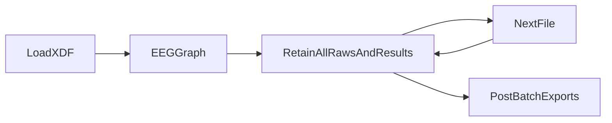
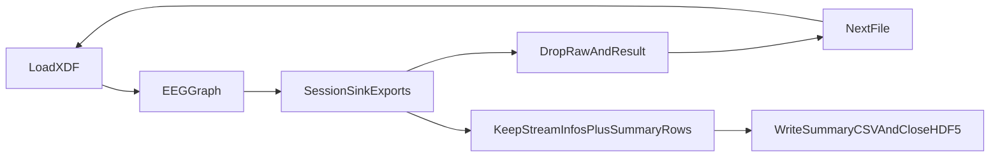

# Stream Analyze Run memory (keep batch opt-in)

## Problem

[`process_XDFs_main`](c:\Users\pho\repos\EmotivEpoc\ACTIVE_DEV\PhoOfflineEEGAnalysis\main_analyze_run.py) stores every finished session’s full `eeg_raw`, `motion_raw`, and `result` (spectrograms + more) in `_out_*` lists. The Analyze Run task (`.vscode/tasks.json` → `python main_analyze_run.py`) then reuses those lists for all exports — so RAM grows ~linearly with session count (55 files × 4 workers).

## Chosen design

- **Default for `__main__` / Analyze Run:** streaming — export each session as soon as it finishes, then drop heavy objects.
- **Opt-in batch:** existing accumulate-all behavior via `retain_in_memory=True` on `process_XDFs_main` (default **True** so notebooks / `SpectogramPlottingHelper.process_XDFs_main(...)` keep today’s API).

## API changes ([`main_analyze_run.py`](c:\Users\pho\repos\EmotivEpoc\ACTIVE_DEV\PhoOfflineEEGAnalysis\main_analyze_run.py))

1. Extend `process_XDFs_main(..., retain_in_memory: bool = True, session_sink: Optional[Callable] = None)`.
   - After a successful worker result (inside the `as_completed` loop), if `session_sink` is set, call it with `(idx, eeg_raw, motion_raw, stream_infos, result)` under a shared lock when the sink touches shared files.
   - If `retain_in_memory` is False: store `stream_infos` only; set `_out_eeg_raw[idx] = None`, `_out_motion_raw[idx] = None`, `_out_results[idx] = None` after the sink returns; do not build the filtered Raw/result lists for return (return `[]` / `None` lists for those, still return concatenated `stream_infos_df` + `sso` / indices as today).
   - If `retain_in_memory` is True: current behavior unchanged (ignore sink for retention; sink may still be called if provided).

2. Worker-side hygiene (both modes): before return from `_subfn_process_single_xdf_file`, `del` the `LabRecorderXDF` holder and unused modality lists (`raws`, `raws_dict` aside from kept EEG/motion) so non-EEG streams are not pinned until GC.

3. Thread-safe export sink for `__main__`:
   - Create output paths / open HDF5 once before the pool (`"w"`), share a `threading.Lock`.
   - Per completed session: HTML (existing single-session path), `.npz` (existing per-session writer), append one HDF5 `/sessions/session_XXX` group (factor the body of `export_spectrograms_hdf5` into a `_write_one_session_hdf5(sgrp, ...)` helper), compute one summary-metrics row (factor scalar logic from `compute_session_summary_metrics`), extract annotation comments into a small list.
   - Then drop references; optional `gc.collect()` every N completions if needed.
   - After pool joins: write summary CSV from accumulated rows; set HDF5 `n_sessions`; close file; for NetCDF/Parquet either build from the finished HDF5 (preferred — no Raw retained) or skip if rebuild is too heavy and document that streaming mode’s interchange primary is HDF5 + per-session `.npz` (keep NetCDF/Parquet in batch/`retain_in_memory=True` path only if rebuild is non-trivial — prefer a thin “HDF5 → NetCDF/Parquet” pass reading disk so Analyze Run still produces the same artifacts).

4. `__main__` wiring:
   - `retain_in_memory=False` + `session_sink=...` when calling `process_XDFs_main`.
   - Remove the post-batch loops that re-walk `active_only_out_eeg_raws` / `results` for HTML/npz/HDF5/summary (those run in the sink).
   - Catalog: keep per-file marks inside the worker; final `sync_from_processed_batch` should use `stream_infos_df` (enrich with `duration_sec` / `meas_date` during processing if needed) rather than requiring live Raw lists — adjust [`sync_from_processed_batch`](c:\Users\pho\repos\EmotivEpoc\ACTIVE_DEV\PhoOfflineEEGAnalysis\src\phoofflineeeganalysis\analysis\session_catalog.py) only if it currently requires Raw objects; otherwise pass empty raws / rely on already-written catalog fields.

## Out of scope

- Changing notebook cells that call batch helpers.
- Changing `.vscode/tasks.json` args (behavior flips via `__main__` default only).
- OpenSpec proposal (behavior fix, not a new product capability).

## Success criteria

- Analyze Run on ~55 XDFs: RSS stays roughly flat after each completion (modulo 4-worker peak), not climbing session-by-session.
- Same on-disk outputs for the streaming path: summary CSV, HTML folder, per-session `.npz`, combined HDF5 (+ NetCDF/Parquet via post-pass from HDF5 if kept).
- `process_XDFs_main(..., retain_in_memory=True)` still returns full Raw/result lists like today.