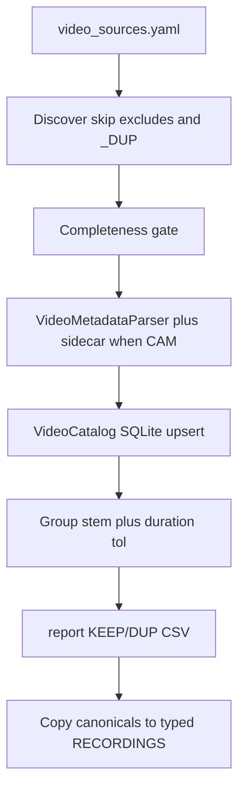

# Video Catalog Ingest and Consolidate

## Decisions (locked)
- **Dedupe**: same filename stem + duration within 1s → one group; prefer `.mkv` as canonical, else largest file size, else newest mtime; others marked `duplicate` (no auto-delete).
- **Catalog**: SQLite at [`PhoOfflineEEGAnalysis/output/video_catalog.sqlite`](c:\Users\pho\repos\EmotivEpoc\ACTIVE_DEV\PhoOfflineEEGAnalysis\output\video_catalog.sqlite)
- **Copy root**: `H:\PhoBehaviorProject\RECORDINGS\{EyeRecordings,WebcamRecordings,ScreenRecordings}\`
- **Scope v1**: video sections only from [`VIDEO_FILES.md`](c:\Users\pho\repos\EmotivEpoc\ACTIVE_DEV\PhoOfflineEEGAnalysis\VIDEO_FILES.md) (Eye / Webcam / Screen). Screenshots and audio deferred.

## Lessons from whisper-timestamped (adopt / adapt / skip)

Relevant stack lives under [`whisper-timestamped/whisper_timestamped/recording_formats/`](c:\Users\pho\repos\EmotivEpoc\ACTIVE_DEV\whisper-timestamped\whisper_timestamped\recording_formats) and [`scripts/iOSWhisperAppHelpers/extract_m4a_creation_times.py`](c:\Users\pho\repos\EmotivEpoc\ACTIVE_DEV\whisper-timestamped\scripts\iOSWhisperAppHelpers\extract_m4a_creation_times.py) — not the upstream Whisper transcription core.

### Adopt into video catalog
- **Skip `_DUP/` during discovery** — [`DUP_DIR_NAME`](c:\Users\pho\repos\EmotivEpoc\ACTIVE_DEV\whisper-timestamped\whisper_timestamped\recording_formats\base.py) + `VIDEO_FILES.md` `--excluding .../_DUP`. Treat `_DUP` as an implicit exclude everywhere.
- **Completeness before cataloging** — [`completeness.py`](c:\Users\pho\repos\EmotivEpoc\ACTIVE_DEV\whisper-timestamped\whisper_timestamped\recording_formats\completeness.py): size/mtime stable + min age; for `CAM_*` prefer finalized `*.timing.json` (`wall_clock_stop_unix`). Avoids ingesting still-recording files (same issue `BaseFileMetadataManager.currently_recording_videos_metadata_df` already hints at).
- **Format-aware naming / sidecars** — reuse ideas (not necessarily import the package) from [`DebutFormat`](c:\Users\pho\repos\EmotivEpoc\ACTIVE_DEV\whisper-timestamped\whisper_timestamped\recording_formats\debut.py) and [`RecContinuousVideoRecorderFormat`](c:\Users\pho\repos\EmotivEpoc\ACTIVE_DEV\whisper-timestamped\whisper_timestamped\recording_formats\rec_continuous.py): filename datetime; when sidecar exists, prefer its wall-clock start and `duration_perf_seconds` over OpenCV probe.
- **Review UX** — keep an `is_duplicate` / keeper report like `mark_creation_time_duplicates` + `print_creation_time_duplicates`: CLI `report` prints KEEP/DUP groups; optional CSV export for spreadsheet review (SQLite remains source of truth).
- **Collision-safe moves/copies** — `_unique_dest_path` pattern when consolidating into typed folders.

### Adapt (do not copy audio dedupe key blindly)
Audio groups on exact `(creation_time, duration, size_mb)` — good for identical m4a re-exports, **bad for mkv→mp4** (size changes after re-encode). Video keeps **stem + duration±1s**, then mkv-preferring keeper sort (audio’s `choose_keeper_index` idea, different key).

### Skip for v1
- Full `RecordingsFormat` registry / GUI / folder-watch / transcription filelists inside whisper-timestamped (wrong package boundary; video catalog owns multi-root categories + consolidate).
- Auto `move_duplicates_to_dup_dir` (quarantine); v1 only marks + consolidates canonicals. Optional later CLI if needed.
- Depending on whisper-timestamped as a runtime dependency for PhoOfflineEEGAnalysis.

## Architecture



Reuse patterns:
- Per-file metadata: [`VideoMetadataParser`](c:\Users\pho\repos\EmotivEpoc\ACTIVE_DEV\PhoPyLSLhelper\src\phopylslhelper\file_metadata_caching\video_metadata.py)
- Durable SQLite API: mirror [`SessionCatalog`](c:\Users\pho\repos\EmotivEpoc\ACTIVE_DEV\PhoOfflineEEGAnalysis\src\phoofflineeeganalysis\analysis\session_catalog.py)
- Completeness / `_DUP` / sidecar: mirror whisper-timestamped helpers (reimplement thin copies under `phoofflineeeganalysis.analysis`, or shared util later)

## Source config

[`PhoOfflineEEGAnalysis/config/video_sources.yaml`](c:\Users\pho\repos\EmotivEpoc\ACTIVE_DEV\PhoOfflineEEGAnalysis\config\video_sources.yaml)

```yaml
categories:
  EyeRecordings:
    - path: "H:/ScreenRecordings/EyeTrackerVR_Recordings"
      recursive: false
  WebcamRecordings:
    - path: "H:/ScreenRecordings/REC_continuous_video_recorder"
      recursive: false
    # ... other webcam roots from VIDEO_FILES.md
  ScreenRecordings:
    - path: "H:/ScreenRecordings"
      recursive: false
      exclude:
        - "H:/ScreenRecordings/EyeTrackerVR_Recordings"
        - "H:/ScreenRecordings/REC_continuous_video_recorder"
    # F:/ and Dropbox screen roots similarly
```

Implicit excludes on every root: any path segment named `_DUP`. Overlapping parents handled via explicit `exclude` so each file gets one category.

## Code changes

### 1. Extend discovery in PhoPyLSLhelper
In [`file_metadata.py`](c:\Users\pho\repos\EmotivEpoc\ACTIVE_DEV\PhoPyLSLhelper\src\phopylslhelper\file_metadata_caching\file_metadata.py) / [`video_metadata.py`](c:\Users\pho\repos\EmotivEpoc\ACTIVE_DEV\PhoPyLSLhelper\src\phopylslhelper\file_metadata_caching\video_metadata.py):
- Add `recursive: bool = False` and `exclude_dirs: Optional[List[Path]] = None`
- Use `rglob` when recursive; skip excluded dirs and any `_DUP` parent
- Keep per-folder `_video_metadata_cache.csv`

### 2. Completeness + sidecar helpers (PhoOfflineEEGAnalysis)
Small module next to catalog (e.g. `video_ingest_helpers.py`) adapted from whisper-timestamped:
- `is_recording_complete(path)` — stable size/mtime; CAM sidecar finalized when present
- `enrich_from_timing_sidecar(path, row)` — override start/duration when sidecar fields exist

### 3. New `VideoCatalog`
[`src/phoofflineeeganalysis/analysis/video_catalog.py`](c:\Users\pho\repos\EmotivEpoc\ACTIVE_DEV\PhoOfflineEEGAnalysis\src\phoofflineeeganalysis\analysis\video_catalog.py)

Schema:
- `videos`: `video_path` PK, `filename`, `stem`, `extension`, `category`, `source_root`, `start_datetime`, `end_datetime`, `duration_sec`, `fps`, `width`, `height`, `file_size`, `mtime`, `format_hint` (`debut`/`cam`/`other`), `duplicate_group_id`, `is_canonical`, `is_duplicate`, `duplicate_reason`, `consolidated_path`, `updated_at`
- `duplicate_groups`: `group_id`, `stem`, `duration_sec`, `canonical_path`, `member_count`

API:
- `discover_and_upsert(...)` — scan → completeness filter → parse → upsert
- `recompute_duplicates(duration_tol_sec=1.0)` — groups + keeper rules
- `load_videos_df()` / `load_duplicates_df()` / `export_review_csv(path)`
- `consolidate(dest_root=..., dry_run=False)` — copy `is_canonical` only into `{dest_root}/{category}/`

### 4. CLI
`pho-video-catalog`: `ingest` | `report` | `consolidate [--dry-run]`  
Default DB: `output/video_catalog.sqlite`

### 5. OpenSpec
Scaffold `openspec/changes/add-video-catalog/` before implementation.

## Duplicate resolution detail
For each group (same `stem`, `|duration_a - duration_b| <= 1.0`):
1. Prefer `.mkv` when mixed containers → losers `converted_container`
2. Else larger `file_size`, then newer `mtime` → `cross_location_copy`
3. Solo `.mp4` → canonical
4. `report` prints KEEP/DUP lines (audio-style); v1 no auto-quarantine

## Out of scope (v1)
- Screenshots / audio from `VIDEO_FILES.md`
- Deleting or moving sources into `_DUP/`
- Content hashing
- Runtime dependency on whisper-timestamped
- Automatic drive-letter remapping (configure present roots in YAML)
