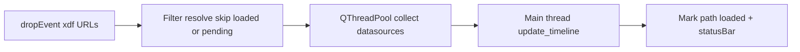

# Drag-drop XDF append onto offline timeline

## Goal

Dropping `.xdf` file(s) onto the offline timeline window **appends** them to the **current** timeline (same semantics as calendar `ensure_xdf_loaded`), without the File→Open **replace** path. Heavy `pyxdf` load + stream processing runs **off the UI thread**; `update_timeline` runs on the main thread.

## Where

Primary work is in **pyPhoTimeline** (not PhoOfflineEEGAnalysis):

- [`MainTimelineWindow.py`](c:\Users\pho\repos\EmotivEpoc\ACTIVE_DEV\pyPhoTimeline\pypho_timeline\widgets\TimelineWindow\MainTimelineWindow.py) — drop events + async job orchestration
- [`timeline_builder.py`](c:\Users\pho\repos\EmotivEpoc\ACTIVE_DEV\pyPhoTimeline\pypho_timeline\timeline_builder.py) — small public helper to collect datasources for one path (worker-safe)
- Reuse [`async_add_track.py`](c:\Users\pho\repos\EmotivEpoc\ACTIVE_DEV\pyPhoTimeline\pypho_timeline\widgets\TimelineWindow\async_add_track.py) `start_add_track_worker` (generic compute → main-thread finished signal)

## Behavior (locked)

| Case | Behavior |
|------|----------|
| One or more `.xdf` files | Append each missing path asynchronously |
| Non-`.xdf` / folders in the drop | Ignore (files only; no recursive dir scan) |
| Already in `_loaded_xdf_paths` or in-flight | Skip; status note |
| Mix of new + already loaded | Load only new ones |
| Viewport | **Do not zoom** (unlike calendar `show_session`); only expand time range via existing `update_timeline(..., update_time_range=True)` |
| No builder / empty timeline | Status/warning; ignore drop |
| Load failure / no streams | Status + refresh log; continue other files |

## Implementation

### 1. Builder: worker-safe collect (no UI)

Add a thin public method next to `ensure_xdf_loaded`, e.g. `collect_datasources_for_xdf_path(xdf_path) -> List[TrackDatasource]`, that:

- Resolves path, applies refresh-config allow/block + prefer_cached
- Calls existing `_collect_new_datasources_for_xdf_path`
- Does **not** call `update_timeline` or mutate `_loaded_xdf_paths`

Keep sync `ensure_xdf_loaded` for IPC/calendar unchanged.

### 2. Window: accept drops

In `MainTimelineWindow.initUI`:

- `self.setAcceptDrops(True)`
- Track `self._xdf_drop_pending: Set[Path]` and `self._xdf_drop_jobs: Dict[token, meta]` (parallel to add-track jobs)

Override:

- `dragEnterEvent` / `dragMoveEvent` — accept if `mimeData.hasUrls()` and any local path ends with `.xdf` (case-insensitive)
- `dropEvent` — extract local file paths, keep only existing `.xdf` files, call `_add_xdf_paths_async(paths)`

If child widgets swallow drops in practice, also `setAcceptDrops(True)` on `contentWidget` and forward via the same handlers (minimal extra wiring).

### 3. Async append pipeline

`_add_xdf_paths_async(paths: List[Path])`:

1. Deduplicate resolved paths; drop already loaded / already pending
2. Status: `Loading N XDF file(s)…`
3. For each path, `start_add_track_worker(...)` with `compute_fn` = `builder.collect_datasources_for_xdf_path(path)`
4. On finished (main thread): if error or empty → log/status; else `builder.update_timeline(...)`, add path to `_loaded_xdf_paths`, clear pending, update status (`Loaded foo.xdf (k tracks)` / summary when last job completes)

Do **not** use `replace_timeline_from_xdf_paths` (that rebuilds/closes the window).

### 4. Feedback

- `statusBar().show()` + short messages for start / skip / success / failure
- Optionally `_append_refresh_log` via builder when available (same channel as refresh)

## Out of scope

- Making calendar IPC `show_session` / File→Open async
- Implementing the older pending plan [`async_xdf_loading_1820f51d.plan.md`](c:\Users\pho\repos\EmotivEpoc\ACTIVE_DEV\PhoOfflineEEGAnalysis\.cursor\plans\async_xdf_loading_1820f51d.plan.md) (full `build_from_xdf_files` rewrite)
- Dropping directories or non-XDF media
- OpenSpec change proposal (small UI affordance on existing append capability)
